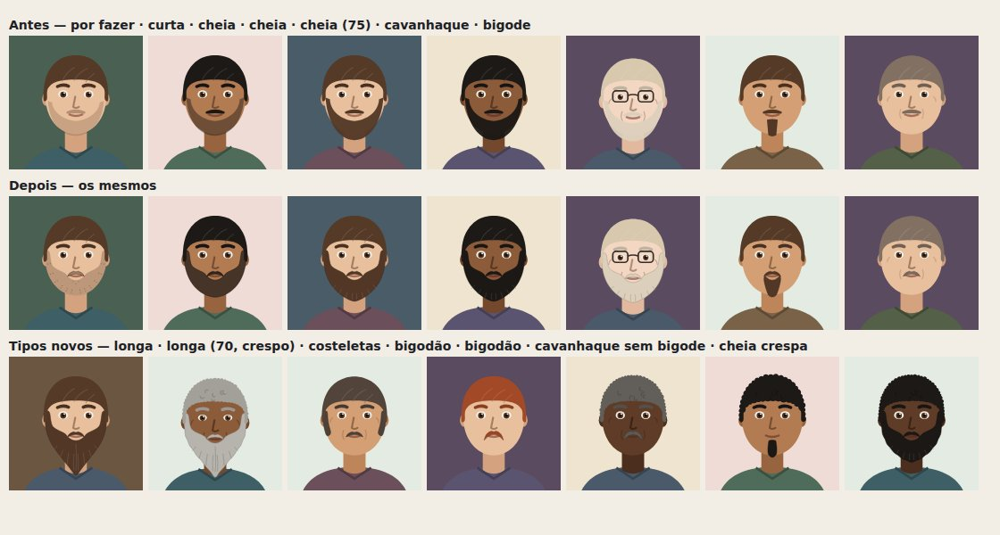
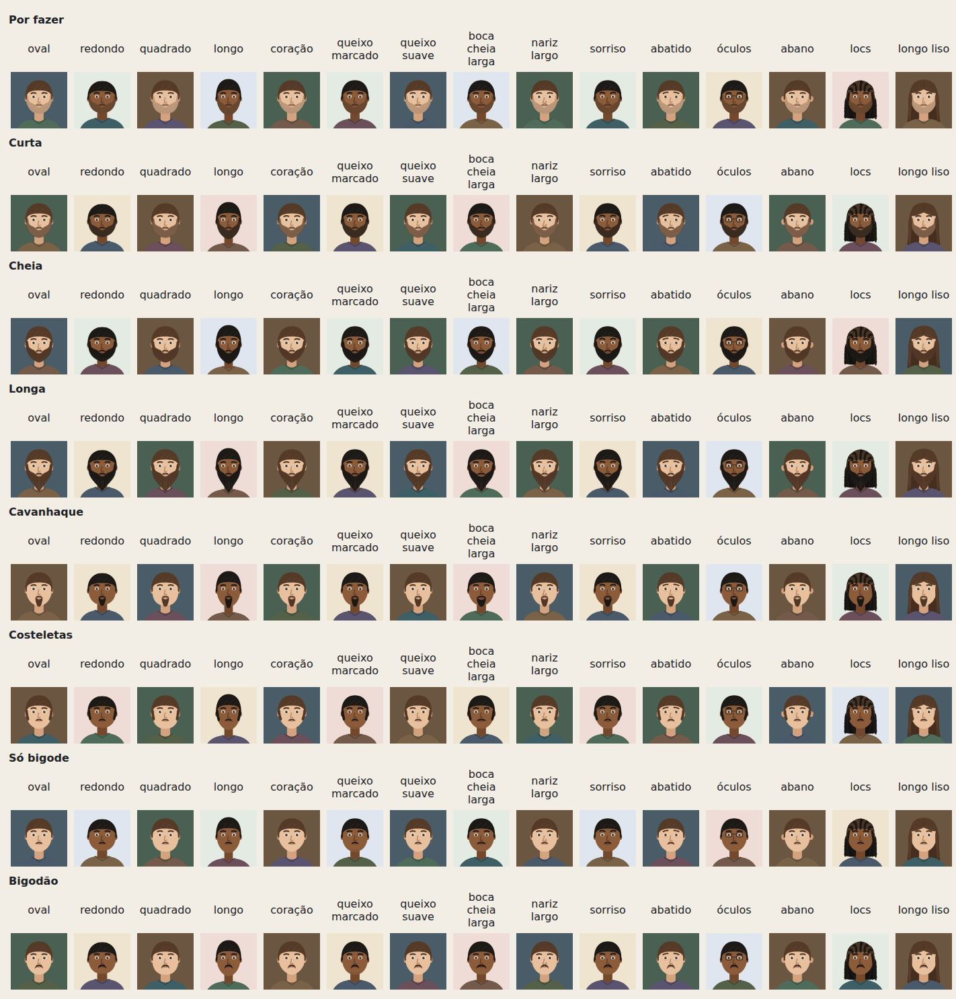
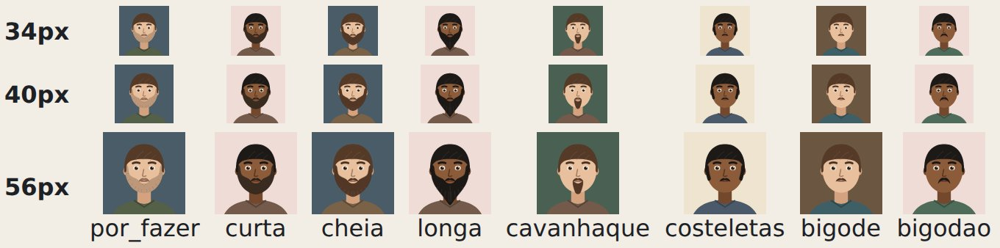

# HOTFIX — Correção das barbas (+ tipos de barba)

Base: HOTFIX cabelos (`a795435`). Branch: `claude/fix-pos-rework3-playtest`. Save: **v20 (sem mudança de versão)** —
os ids de barba antigos continuam valendo.

Imagens: `docs/hotfix-barbas/`. Galeria: `scripts/playtest/galeriaBarbas.tsx`. Auditoria geométrica:
`scripts/playtest/barbas.mjs`. Testes: `src/ui/__tests__/barbas.test.tsx`.

---

## 1. O defeito

Em `src/ui/avatar/Retrato.tsx`, a barba (`Barba`) tinha geometria própria, fixa, sem ligação com o rosto desenhado:

1. **Um anel solto do bigode.** A "cheia" e a "curta" eram uma faixa de queixo cujo recorte de dentro ia até
   `olhoY + 16` no meio — abaixo da boca — e subia reto pelas bochechas. O bigode ficava sozinho em cima: **a boca
   ficava numa ilha de pele**, cercada de barba sem tocar nela. Nenhuma barba de verdade é assim.
2. **O bigode era uma fita fina colada no lábio** (`olhoY + 8,6` a `+ 11`, sempre 10 de largura), igual em qualquer
   boca: na boca larga não cobria os cantos; na abatida (cantos caídos), o meio da boca passava por cima dele.
3. **Curta e por fazer eram manchas translúcidas** (`opacity` 0,45 e 0,22 da cor do fio): na pele escura, a curta
   virava sombra suja; a por fazer, uma mancha.
4. **O cavanhaque era um retângulo** pendurado no queixo, sem ligação com o bigode — parecia uma gravata.
5. **Barba grisalha sumia na pele clara** (sem contorno, cor quase igual à pele).
6. A barba **não acompanhava o rosto**: a curva da mandíbula da barba não era a do contorno (rosto redondo, quadrado,
   coração, queixo marcado), nem a boca (largura, expressão), nem o tipo de cabelo.

## 2. A correção

A `Barba` foi reescrita em torno de duas regras: **a barba segue a mandíbula do próprio rosto** e **barba e bigode são
uma massa só, com a boca numa abertura**.

- **Mandíbula real**: a borda de fora da barba é a mesma curva do contorno do rosto (`mandibula(g, t)`: a cúbica da
  mandíbula, com a normal para fora), empurrada pelo volume de cada barba — por fazer 0,25, curta 0,9, cheia 2,3,
  longa 2,7 — e crescendo para o queixo. Rosto redondo, quadrado, longo, coração e queixo marcado/suave mudam a barba.
- **Costeletas nascem debaixo do cabelo** (altura da orelha, por baixo da camada da frente do cabelo), descem e fecham
  no queixo.
- **A linha da bochecha** desce da costeleta até o **canto da boca**, onde encontra o bigode; por baixo, a barba
  contorna o lábio de baixo com folga (mais folga no sorriso e na boca cheia). A boca nunca é coberta.
- **O bigode acompanha a boca**: a largura é a da boca do retrato (estreita, larga, cheia, fina; tensa, sorrindo), fica
  entre o nariz e o lábio de cima, e sobe quando os cantos caem (abatido, doente) — o meio da boca fica livre.
- **Cor sólida**: curta é a cor do fio misturada à pele (barba aparada mostra a pele, mas é barba, não sombra); por fazer
  é a sombra da barba com os pontinhos dos fios; cheia e longa têm fios desenhados no comprimento.
- **Contorno** fino na cor do fio escurecida: grisalho e loiro não somem mais na pele clara.
- **Tipo de cabelo**: com cachos (encaracolado, cacheado, crespo) a borda da barba é ondulada em cachinhos; liso e
  ondulado, borda lisa.
- **Fim da adolescência (16–18)**: a barba é rala (mais clara, menos volume, a longa não passa de curta).
- O código geométrico novo vive só em `Retrato.tsx`; a boca agora é calculada uma vez e usada pela boca e pela barba.

## 3. Mais tipos? Sim — o que faltava

O catálogo tinha 5 barbas (por fazer, curta, cheia, cavanhaque, só bigode). Faltavam formas comuns e reconhecíveis —
especialmente para os personagens mais velhos e para a variedade da gente do mundo, onde as mesmas cinco se
repetiam. Entraram quatro, cada uma com **desenho próprio**:

| Novo | O que é |
|---|---|
| **Longa** | barba cheia que desce além do queixo e afina na ponta, com fios no comprimento |
| **Costeletas** | só as laterais, da orelha à mandíbula (com bigode, o visual retrô; sem, as costeletas sozinhas) |
| **Bigodão** | bigode grosso, mais largo que a boca, com as pontas descendo pelos cantos |
| **Cavanhaque sem bigode** | o mesmo cavanhaque com "Com bigode" desmarcado: só o tufo do queixo |

O cavanhaque com bigode também mudou de forma: agora é o **cavanhaque fechado** (o círculo em volta da boca).

Decidi **não** acrescentar mais que isso: as variações seguintes (chin strap, âncora, barba de lenhador, imperial) são
pequenas demais para ler num retrato de 34–56 px, que é o tamanho em que a maioria das pessoas aparece no jogo.

Onde aparece:

- **Você · Aparência e estilo**: o seletor "Barba" lista as 9 opções (`dados/estilo.BARBAS`); "Com bigode" aparece em
  todas as que podem ir com ou sem (`BARBAS_COM_BIGODE`: por fazer, curta, cheia, longa, cavanhaque, costeletas).
  Pôr uma barba longa ou um bigodão "se nota de longe" (`estilo.marcante`), como a cheia já se notava.
- **Nascer**: "Barba quando adulto" agora lista o catálogo inteiro (antes eram 4 opções escritas à mão, sem por fazer).
- **Gente do mundo**: o sorteio de sempre (bigode, cavanhaque, curta, cheia) ganhou a variação
  `identidade.variarBarba` — 22% das cheias viram longas, 30% dos bigodes viram bigodões, 25% das curtas ficam por fazer
  e 7% viram costeletas, 25% dos cavanhaques ficam sem bigode — num gerador semeado pelo rosto. **A sequência do gerador
  da vida não mudou** (20 000 pessoas, semente 42: mesmo valor final antes e depois), e a herança dos filhos é semeada
  pela barba de origem, então nenhum traço herdado se move. Em 20 000 homens: longa 1,7%, bigodão 2,3%, por fazer 1,6%,
  costeletas 0,5%, cavanhaque sem bigode 2,1%.

## 4. Auditoria

**Galeria** (`galeriaBarbas.tsx`): toda barba × 4 idades (17, 30, 55, 75) × 5 combinações de pele e cor; × 15
variações (5 rostos, queixo marcado e suave, boca cheia e larga, nariz largo, sorriso, abatido, óculos, orelhas de
abano, locs, cabelo longo); miniaturas de 34, 40 e 56 px; zoom de 240 px; e toda barba × com e sem bigode × 6
expressões × 4 bocas × 3 idades. Inspecionada visualmente.

**Auditoria geométrica** (`barbas.mjs`, num Chromium, com `isPointInFill`): em cada retrato com barba,

- o **meio da boca** não está debaixo da barba nem do bigode; os **cantos**, não debaixo da massa da barba;
- os **olhos** e o **nariz** ficam livres;
- a barba cabe no quadro.

Resultado: **1480 retratos com barba, 0 problemas.** Para conferir que a auditoria pega defeito de verdade, a abertura
da boca foi estragada de propósito (o lábio de baixo encostado nos cantos): **486 problemas** apontados; desfeito.

## 5. Validação

Node 22.23.2:

- **Suíte completa: 1310 testes, 75 arquivos, todos passando** (HOTFIX cabelos: 1302 em 74; +8 deste hotfix).
  Nenhum teste existente foi alterado.
- **Novos — `src/ui/__tests__/barbas.test.tsx` (8)**: toda barba × com e sem bigode × 16/25/50/80 × 4 expressões ×
  5 rostos × liso/crespo desenha caminhos válidos e marca barba e boca; nenhuma barba antes dos 16 nem em rosto
  feminino; a barba desce até o queixo, a cheia passa dele, a longa bem além (e é menor aos 17); o bigode vai junto e
  sai quando a pessoa tira; o bigodão é mais largo que o bigode; Aparência e estilo (as 9 opções, "Com bigode" só onde
  cabe, cavanhaque sem bigode, longa); o motor aceita o catálogo e recusa barba inventada; Nascer lista o catálogo;
  a gente do mundo usa os tipos novos, a variação é estável e a sequência do gerador da vida é a mesma.
- Typecheck: ok. Build: ok. Bundles abaixo de 800 kB (`motor` 747,63 kB; `Retrato` 95,34 → 98,36 kB).
- APK regenerado do build final (`public/android/vida.apk`, SHA-256
  `8a015838a7038dbe41224f7e12f471c8ec48cecc8156d2ebe639ff06a0deeb00`). Não testado em aparelho real.

## 6. O que ficou de fora / pendências

- Sem teste em aparelho real; miniaturas conferidas em Chromium.
- A barba não cresce sozinha com o tempo (por fazer não vira cheia se a pessoa "deixar"): é escolha, como o corte.
- Pessoas não binárias continuam podendo ter barba (`podeTerBarba` olha o gênero ≠ feminino, regra anterior).
