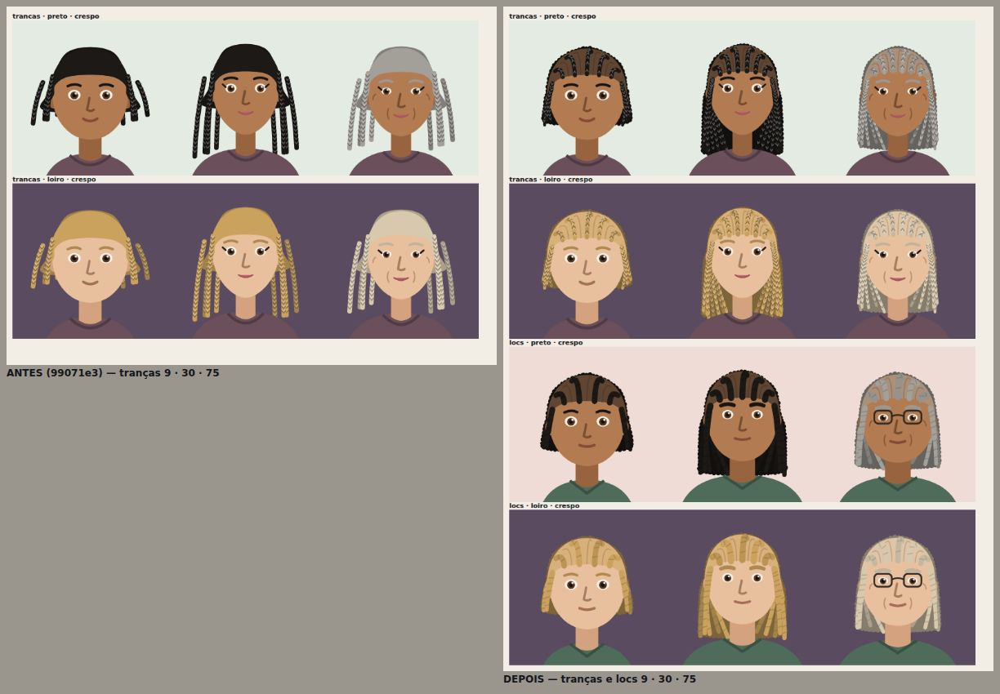
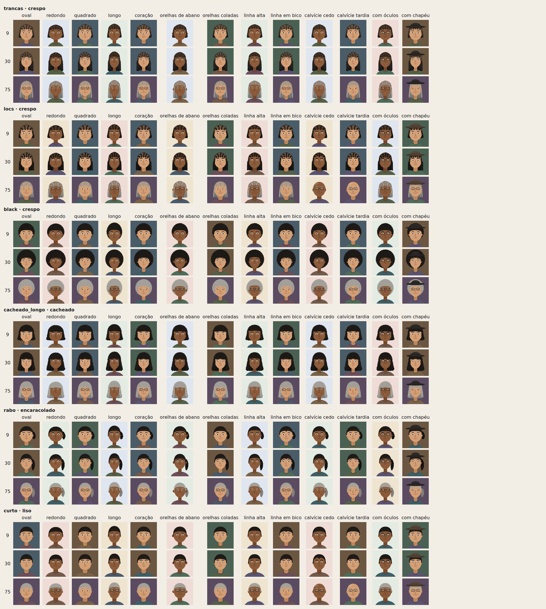
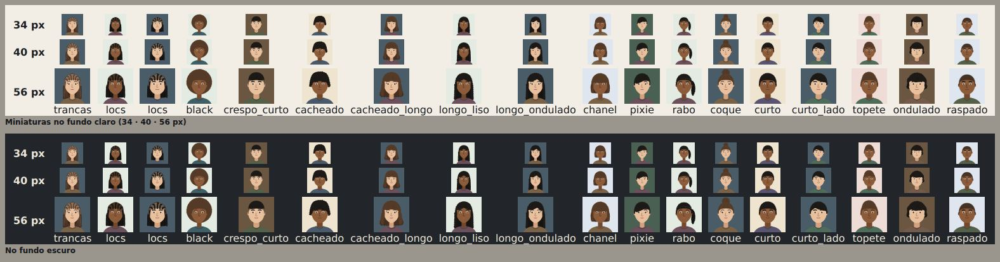
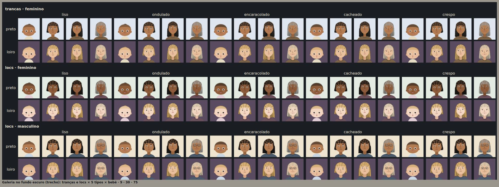
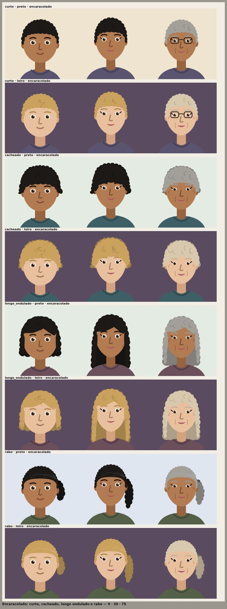
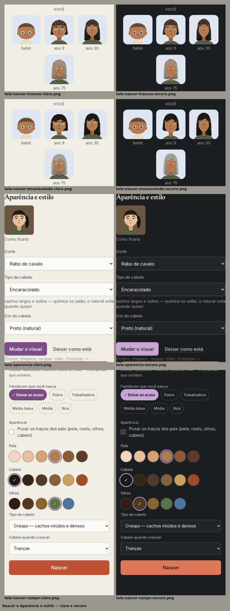

# HOTFIX — Correção e auditoria dos cabelos (+ tipos de cabelo)

Base: REWORK 6.5 (`99071e3`). Branch: `claude/fix-pos-rework3-playtest`. Save: **v20 (sem mudança de versão)**.

Imagens: `docs/hotfix-cabelos/`. Galeria: `scripts/playtest/galeriaCabelos.tsx`. Auditoria geométrica:
`scripts/playtest/cabelos.mjs`. Testes: `src/ui/__tests__/cabelos.test.tsx`.

---

## 1. O defeito

No playtest, uma personagem de tranças aparecia, nas prévias de 9, 30 e 75 anos, com as tranças **soltas da cabeça**:
mechas laterais isoladas, penduradas ao lado do rosto, e uma passagem estranha entre o alto da cabeça e o comprimento.

## 2. A causa

Em `src/ui/avatar/cabelos.tsx`, o corte `trancas` (e `locs`, que divide o mesmo código) era montado com três peças
**sem ligação entre si**:

1. **No alto, uma tampa lisa** (`calota`) — sem nenhuma trança: o alto da cabeça não tinha trama nem repartição, então
   não havia nada que levasse da testa ao comprimento.
2. **Atrás, seis cordões nascendo na altura da orelha** (`y0 = cy − 6`), com as raízes em `x = cx ± f·(w/2)` para
   `f` = 0,72, 1,0 e **1,25** — ou seja, os dois de fora nasciam **a 1,25 × a meia-largura da cabeça, no ar**, ao lado do
   crânio, e ainda abriam em leque para fora (`x1 = cx ± f·(w/2 + 4)`). Na criança (cabeça proporcionalmente mais
   larga, tranças curtas) o leque ficava horizontal: pareciam varetas.
3. **Na frente, um cordão de cada lado** começando no canto da testa, sem continuidade com os de trás.

A auditoria geométrica nova (§5), rodada sobre o código antigo, mede isso: **628 raízes de cordão fora de qualquer área
de cabelo** (todas as combinações de tranças e locs) — por exemplo, `(25,6; 40)` e `(74,4; 40)` aos 9 anos, a 4 unidades
da cabeça.

## 3. A correção

O corte foi reescrito em torno de uma regra física: **todo cordão nasce dentro de uma área já pintada de cabelo e cai
pela gravidade**.

- **No alto, os próprios cordões**: saem da linha do cabelo (a linha herdada — reta, em bico ou alta, que recua com a
  calvície; `pontoNaLinha`) e vão para os lados e para trás, com **risca no meio**, terminando na borda do crânio — exatamente
  onde nascem os cordões que descem pelos lados. Entre eles, as repartições mostram o couro (cor da pele misturada ao
  cabelo). É essa continuidade que liga a testa ao comprimento.
- **Atrás**, uma massa (o volume de todos os cordões de trás) desce da cabeça até o fim, e os cordões visíveis dos lados
  nascem **na borda do crânio** (`H(g, −0,6)`, de 178° a 126°), encostam na cabeça e caem quase retos — sem leque.
- **Na frente**, as mechas que caem ao lado do rosto nascem na têmpora, dentro da calota, e passam por cima da orelha.
- **Idades**: a criança tem cordões até o queixo; o idoso, menos cordões (densidade) e mais finos; o cinza do
  envelhecimento continua o do retrato. O bebê continua com a penugem da textura da família.
- **`Cordao`** (o desenho de um cordão) passou a aceitar uma curva qualquer, afina na ponta, e conta os gomos da trança
  pelo **comprimento** (antes, pela altura — um cordão que sobe pela cabeça ficava sem trama), com os gomos seguindo a
  direção do cordão.

Nenhum outro corte mudou de silhueta; a genética, a textura herdada e o catálogo de cortes ficaram iguais.

## 4. Auditoria dos penteados — o que mais apareceu e foi corrigido

Galeria nova (`galeriaCabelos.tsx`): **18 cortes × 5 tipos × 4 idades (bebê, 9, 30, 75) × 2 cores**, em fundo claro e
escuro (os dois temas); os cortes mais longos e volumosos em **cada rosto** (oval, redondo, quadrado, longo, coração),
orelhas de abano e coladas, linha do cabelo alta e em bico, calvície cedo e tardia, óculos e chapéu, aos 9, 30 e 75;
e **miniaturas** de 34, 40 e 56 px (listas de pessoas, "Em casa", cabeçalho). Inspecionadas visualmente em detalhe
(zoom de 260 px) e medidas (§5).

| Achado | Onde | Correção |
|---|---|---|
| Tranças e locs soltas da cabeça | §2 | §3 |
| **Black cortado no alto** do retrato (a coroa passava de `y = 8`, o começo do quadro, e saía com o topo reto) | black adulto, em todas as combinações (35 retratos na galeria) | o volume que não cabe para cima vai para os lados (`ry` limitado ao quadro, `rx` +0,8) |
| Traços retos de brilho (os "fios" do liso) desenhados sobre cabelo com cachos | longos, chanel, curto de lado, topete, ondulado, pixie com textura cacheada/crespa | com cachos, a massa mostra cachinhos; o brilho em fios fica para o liso e o ondulado |
| Chanel com cachos com a barra de trás lisa | chanel cacheado/crespo | a barra de trás também leva a textura |

Conferido e **sem defeito**: curtos, raspado, crespo curto, cacheado, longos, rabo, coque, pixie, topete; calvície
integrada à linha da testa; óculos e chapéu por cima do cabelo; orelhas de abano (o cabelo não as atravessa); o mesmo
rosto do bebê aos 75. Em miniatura (34 px), tranças e locs continuam reconhecíveis e presas à cabeça.

## 5. Auditoria geométrica (complementa a inspeção visual)

`scripts/playtest/cabelos.mjs` abre as galerias num Chromium e mede, em cada retrato (as camadas do cabelo agora são
marcadas no SVG — `.retrato__cabelo--atras/--frente`, a raiz de cada cordão em `data-raiz`, os olhos em `.retrato__olho`):

- **não flutua**: a raiz de cada cordão está dentro de um caminho preenchido de cabelo (`isPointInFill`);
- **não é cortado**: o cabelo cabe no quadro (alto ≥ 8, lados entre 10 e 90; o comprimento pode descer atrás do corpo);
- **não cobre o rosto**: o centro de cada olho não está debaixo do cabelo da frente.

| | Antes (`99071e3`) | Depois |
|---|---|---|
| Retratos medidos | 1494 (4 tipos) | 1782 (5 tipos) |
| Cordões nascendo fora do cabelo | **628** (380 locs, 248 tranças) | **0** (4353 raízes conferidas) |
| Cabelo cortado pela borda | **35** (black) | **0** |
| Cabelo da frente sobre os olhos | 0 | 0 |

Os testes automatizados não substituem a inspeção: as imagens deste relatório foram olhadas uma a uma, e foi a
inspeção que achou os brilhos retos no cabelo com cachos (que nenhuma medida pegaria).

## 6. Tipos de cabelo (pedido junto)

Em **Você · Aparência e estilo**, um campo novo, **Tipo de cabelo**: Liso · Ondulado · **Encaracolado** · Cacheado ·
Crespo, com o natural marcado "(natural)" e uma nota curta do que é cada um. A prévia mostra o rosto antes de mudar.

- **"Encaracolado"** ganhou desenho próprio: cachos largos e soltos (arcos maiores e mais abertos na borda, cachinhos
  maiores dentro da massa) — entre o ondulado e o cacheado; não é um rótulo novo para um desenho velho.
- **A aparência muda; a genética, não.** Mudar o tipo é química de salão (alisar, relaxar, fazer cachos): antes da
  primeira mudança, os genes ficam guardados (`identidade.guardarGenes`), e **os filhos herdam o tipo natural**
  (`geneticaDe`) — a mesma regra da tinta e da cirurgia. Voltar ao natural é sempre possível.
- **Idade**: a química passa pela família antes dos 13 (`AUTONOMIA.aparencia`); a criança vê só o tipo que tem.
- **No Nascer**, sem "Puxar os traços dos pais", também dá para escolher o tipo de nascença (com os pais, ele vem deles).
  Quem nasce encaracolado tem os cortes que combinam com cachos.
- Motor: `MudancaVisual` aceita `textura`; `dados/estilo.TIPOS_DE_CABELO`; `estilo.texturaNatural`. A lista genética
  (`identidade.TEXTURAS`) **não mudou** — o sorteio de quem nasce é o mesmo de antes (nenhum teste semeado se moveu).

## 7. Validação

Node 22.23.2:

- **Suíte completa: 1302 testes, 74 arquivos, todos passando** (REWORK 6.5: 1290 em 73; +12 deste hotfix). Nenhum
  teste existente foi alterado.
- **Novos — `src/ui/__tests__/cabelos.test.tsx` (12)**: todo corte × todo tipo × bebê/9/30/75 × dois gêneros desenha
  caminhos válidos e marca as camadas do cabelo; toda raiz de cordão de tranças e locs fica junto do crânio (meia-largura
  ≤ 21,5 — antes, 24,4) e acima do queixo, em todos os rostos e idades; o alto tem cordões saindo da testa; o idoso tem
  menos cordões; o encaracolado é diferente do liso e do cacheado; cabelo com cachos não ganha o brilho reto; alisar aos
  25 muda o visual e não os genes (e fazer cachos depois também não); a química espera antes dos 13; voltar ao natural,
  sempre; o seletor em Aparência e estilo (cinco tipos, "(natural)", prévia, mudança) e no Nascer.
- **Auditoria geométrica** (§5): 1782 retratos, 4353 raízes, **0 problemas** (antes: 663).
- **Inspeção visual**: galerias de cortes (claro e escuro), rostos e miniaturas, zoom de 260 px de tranças, locs e
  encaracolado; telas reais (Nascer e Aparência e estilo) no build de produção, nos dois temas, sem erros de console.
- Typecheck: ok. Build: ok. Bundles abaixo de 800 kB (`motor` 747,63 kB; `Retrato` 92,37 → 95,34 kB).
- APK regenerado do build final (`public/android/vida.apk`, SHA-256
  `5d5f7e76661df1a95852ca0f3d3eab15013983ab71b04bb024fc0d5108c17934`; os 38 arquivos do jogo idênticos ao `dist/`).
  Não testado em aparelho real.

## 8. O que ficou de fora / pendências

- Sem teste em aparelho real; as miniaturas foram conferidas em Chromium (34–56 px).
- O tipo de cabelo escolhido não "cresce de volta" sozinho com o tempo (a transição capilar levaria anos): fica até a
  pessoa voltar ao natural.
- Black com chapéu continua desenhando o chapéu sobre o volume (comportamento anterior, não mexido).
- Homens com calvície herdada ("cedo") ficam calvos na velhice mesmo com locs — a calvície vence o corte (regra
  anterior do retrato).
