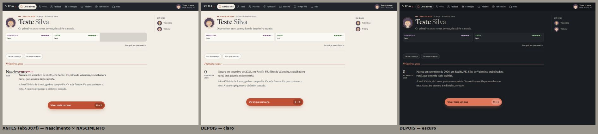
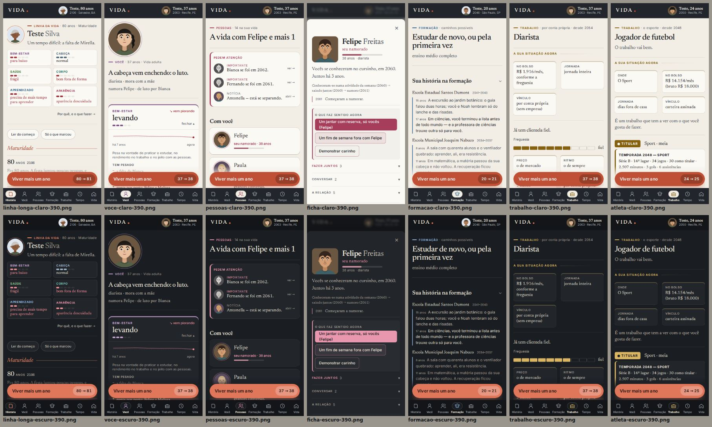
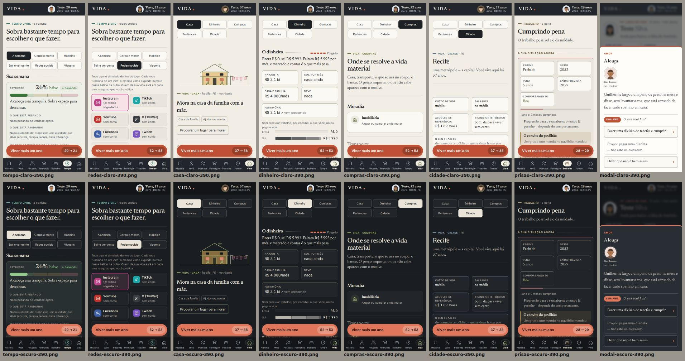
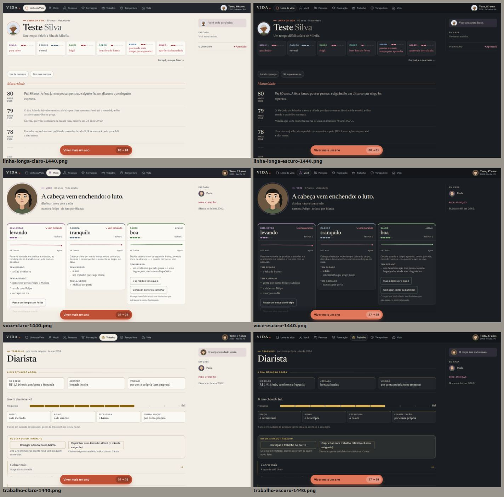
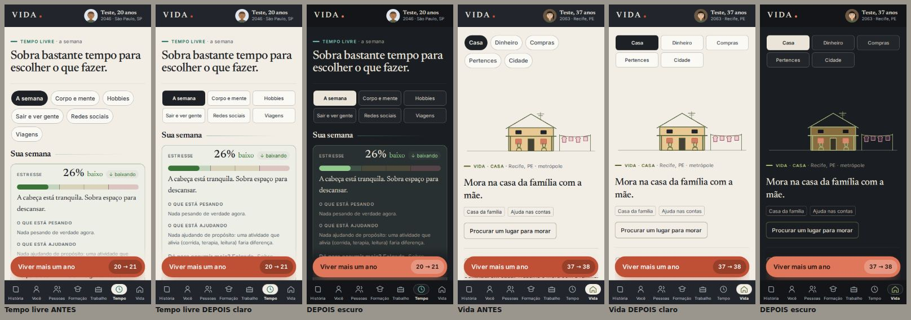
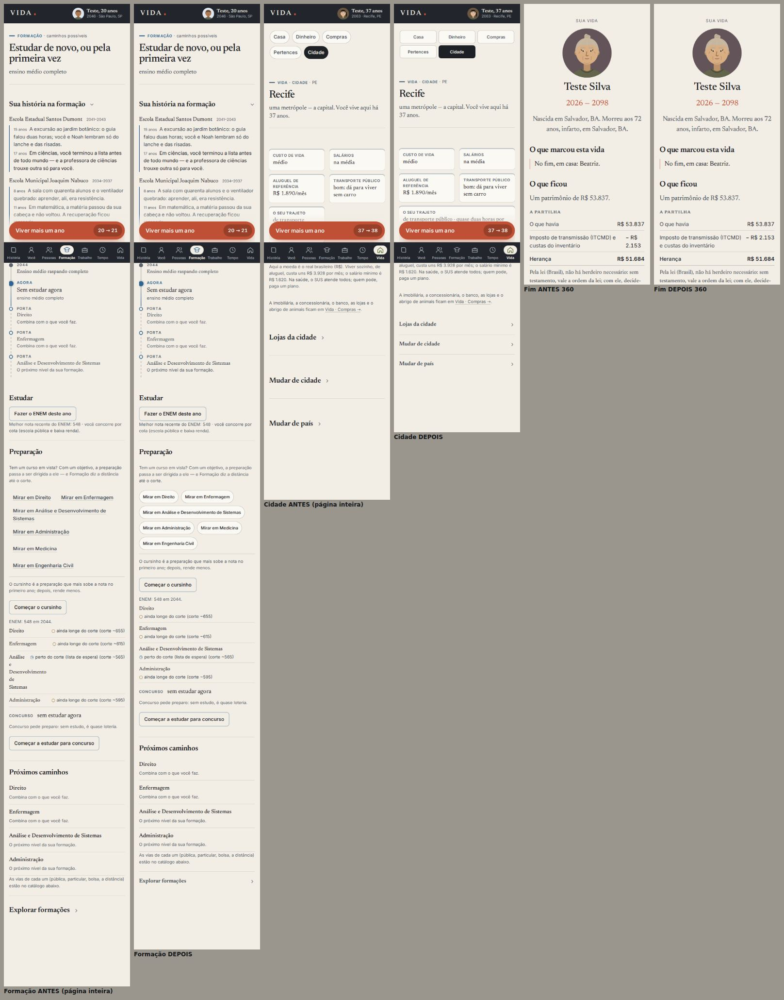
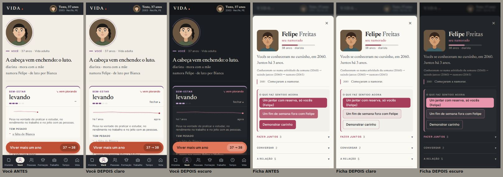
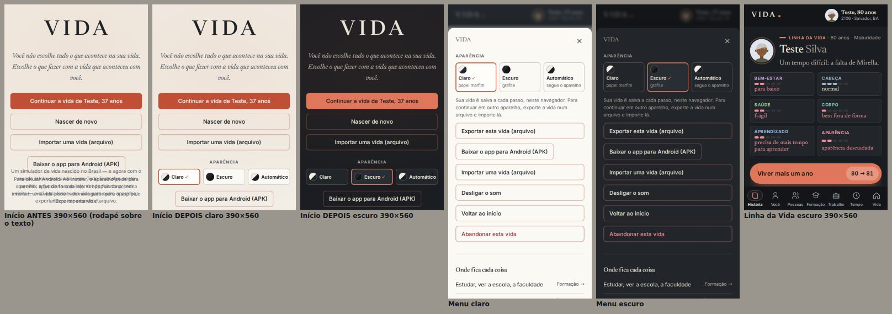
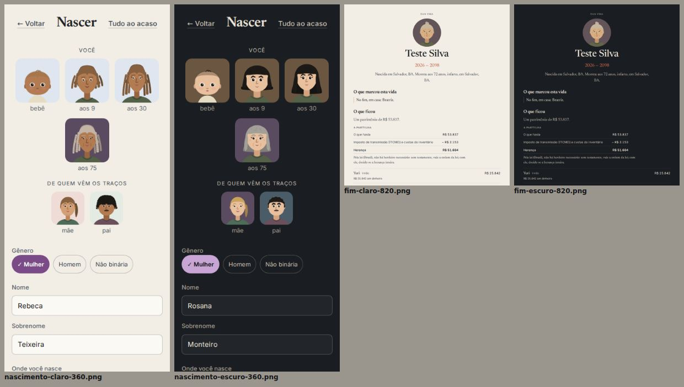

# REWORK 6.5 — Sistema visual global, temas e consistência de interface

Base: REWORK 6 (`eb5387f`). Branch: `claude/fix-pos-rework3-playtest`. Save: **v20 (sem mudança de versão, sem campo novo)**.

Pacote visual e de usabilidade: nenhuma regra do motor mudou (os bundles do motor saíram **byte a byte iguais**, mesmos
hashes do REWORK 6 — §9). Tudo o que a tela mostra continua vindo das mesmas funções do motor.

Imagens: `docs/rework65/` (JPEG). Auditoria: `scripts/playtest/rework65.mjs` (geometria real, dois temas, cinco
tamanhos). Testes: `src/ui/__tests__/rework65.test.tsx`.

---

## 1. Diagnóstico (auditoria antes de mexer)

Capturas do build de `eb5387f` com os saves do REWORK 6 (`gerarRework6.ts`: bebê, criança, jovem, adulta, idosa de 80
anos, decisão aberta, atleta, presa, rica, vida encerrada) em 26 cenas que cobrem todas as áreas, modais, Menu, Início,
Nascer e Fim. Para não depender só do olho, a auditoria nova **mede a geometria**: cada linha de texto visível vira um
retângulo (`Range.getClientRects`, recortado pelas caixas com `overflow` que a contêm e ignorando o que está escondido
— `checkVisibility`, `
` fechado, `sr-only`); dois retângulos de elementos diferentes que se cruzam são
sobreposição. Também mede rolagem horizontal, elementos estourando a borda, o botão de avançar visível e livre, alvos
de toque e erros de console.

| Achado | Onde | Causa |
|---|---|---|
| **"Nascimento" × "NASCIMENTO" sobrepostos** (o caso do playtest) | Linha da Vida, ano 0, desktop e tablet (1440/820) | §2 |
| Faixa cinza vazia ao lado dos sinais | Linha da Vida (bebê: 2 sinais numa grade de 3) | a grade pintava o fundo de cinza para fazer os fios; casa vazia = cinza |
| Casas vazias ao lado de fichas de dados | Trabalho, Cidade, Prisão (3 ou 5 fichas em 2 colunas) | `auto-fill` + nenhuma regra para a ficha que sobra |
| Seções de Tempo livre em **três linhas** quebradas no celular (um terço da tela antes do conteúdo) | Tempo livre, Vida | fila `flex-wrap` que quebrava onde dava |
| Três seções recolhidas seguidas pareciam página em branco (~90 px de vão cada) | Cidade, Trabalho | o respiro de seção aberta valia também fechada |
| Curso espremido **uma palavra por linha** ("Análise / e / Desenvolvimento / de / Sistemas") | Formação, nota × corte | coluna `auto` da leitura da nota roubava a largura do nome |
| Seis links sublinhados iguais ("Mirar em…") | Formação | lista de escolhas sem forma de escolha |
| Três botões cheios iguais em "O que faz sentido agora" | Ficha de pessoa | toda prioridade virava `principal` |
| "+"/"−" solto no canto dos cartões | Você | o convite a abrir era um sinal sem palavra |
| Linha da trajetória com 160 px soltos num cartão largo, sem legenda | Você | largura máxima fixa |
| "– R$" numa linha e "2.153" na outra | Fim (partilha) | regra do REWORK 5 deixava o valor quebrar ≤ 420 px |
| **Rodapé deitado sobre o texto do APK** (medido em 390×560) | Início | `position: absolute` no fundo da tela — numa janela baixa (teclado, paisagem), sobre os botões e o aviso do APK |
| Menu sem teclado (Esc não fechava, foco não entrava) | Menu | uma cópia da folha sem o comportamento da `Folha` comum |
| Rótulo da semana com fundo branco fixo | Tempo livre | `rgba(255,255,255,.86)` + tinta da paleta — no escuro, tinta clara em fundo branco |
| Sombras feitas com a cor da tinta | tokens | no escuro, a tinta é marfim: as sombras **acenderiam** |
| Abas de seção sem setas do teclado | Vida, Tempo livre | `role="tab"` sem o padrão de teclado |
| Não havia tema escuro | — | — |

A primeira passada do detector também acusou Ficha, Dinheiro, Tempo livre e Fim — eram textos dentro de `
`
fechados, que `getClientRects` ainda mede. O detector passou a usar `checkVisibility` e **a auditoria "antes" foi
refeita** sobre o build de `eb5387f`: sobraram exatamente os problemas reais — os 4 "Nascimento × NASCIMENTO" e o
rodapé da tela inicial em 390×560.

O que **não** era problema e ficou: a moldura grafite, o coral como única cor de agir, o papel marfim, o botão de
avançar sticky, a janela de 20 anos, as fichas `.dado`, os retratos. A base do REWORK 6 era boa; faltava virar sistema.

## 2. A sobreposição da Linha da Vida — a causa

`.ano__corpo` é uma grade de duas colunas: a margem (a idade) com **76 px fixos** e o texto. A idade é escrita em
`2rem` de serifa. Para o ano 0, o componente escrevia a **palavra** "Nascimento" no lugar do número: ~170 px de texto
numa coluna de 76 px. Item de grade não encolhe o texto — a palavra transbordava para a coluna do texto e se deitava
sobre o primeiro acontecimento, que era o marco do nascimento com o tema em versalete, "NASCIMENTO". No celular a
margem já vira uma linha acima do texto, por isso a sobreposição só aparecia de 760 px para cima.

Correção na origem, não no sintoma:

- **A margem só leva número**: o nascimento é **"0 · ao nascer"** (a unidade pequena embaixo, como "37 · anos").
- **A margem é medida em `rem`** (5rem): cresce junto com o texto aumentado/zoom em vez de ficar em 76 px enquanto o
  número cresce. E `min-width: 0` + `overflow-wrap: anywhere` garantem que nada do que mora nela a atravesse.
- **O tema não repete a margem**: o marco do nascimento no ano 0 não ganha "NASCIMENTO" de novo (`temaDoMarco`); em
  qualquer outro ano (um filho que nasce aos 31), o tema aparece.
- **A ordem de leitura de todo acontecimento** passou a ser estrutural: idade/ano (margem) → **tipo numa linha própria**
  (`.entrada__tipo`: o tema do marco, "sua escolha") → narrativa. Antes, "sua escolha" era um selo no fim da frase.
  Consequências (`tom` bom/ruim) seguem marcadas no ponto do tema (cheio/vazado) e não só pela cor.

Medido: depois da correção, **0 sobreposições** nas 26 cenas × 2 temas × 5 tamanhos (§7).

## 3. Arquitetura dos temas

**Uma porta, um atributo, uma camada.**

- `src/ui/tema.ts` — a única porta: `lerAparencia` / `guardarAparencia` (localStorage `VIDA_APARENCIA`),
  `resolverTema` (o Automático pergunta `prefers-color-scheme`), `aplicarTema` (põe `data-tema` no `<html>` e pinta a
  meta `theme-color`), `escolherAparencia`, `iniciarTema` (no Automático, acompanha o sistema ao vivo — lê a
  preferência no momento da mudança).
- `index.html` — um script em linha de 12 linhas, **antes de qualquer CSS e do React**, faz o mesmo cálculo e aplica o
  atributo: a primeira pintura já sai no tema certo, sem piscar. Não usa rede (só localStorage e `matchMedia`), então
  funciona offline e no APK. Sobrevive a localStorage bloqueado (modo privado → segue o sistema). Um teste roda o
  script e compara com `tema.ts` em todas as combinações.
- `tokens.css` — o tema escuro é **um bloco só**, `:root[data-tema='escuro']`, que redefine **apenas a camada de
  paleta (`--p-*`)**. A semântica (`--fundo`, `--tinta`, `--acao`…) e os nomes antigos seguem sozinhos, porque já eram
  derivados da paleta desde o REWORK 6. Não há uma segunda folha, nem `if (tema)` em componente algum (teste: nenhuma
  folha de área nem componente menciona `data-tema` ou `prefers-color-scheme`). Duas cores entraram na paleta para
  isso funcionar: `--p-sobre-tom` (texto sobre tom preenchido; era `#ffffff` fixo) e `--p-sombra` (as sombras eram
  feitas com a tinta — acenderiam no escuro). E `--p-acao-pastilha` (a pastilha da idade no botão de avançar).
- **Persistência sem tocar no save**: a aparência é do aparelho (como o som), não da vida — trocar de vida não troca o
  tema; o save continua v20, byte a byte igual antes e depois de trocar o tema (teste).
- **Controle**: Menu (o "VIDA" no alto, que já era o lugar de exportar, som etc.) ganhou **Aparência** como primeiro
  item; a tela inicial também tem o seletor (compacto), para escolher antes de nascer. É um grupo de rádio de verdade
  (setas, um só na ordem do Tab, `aria-checked`), com amostra e palavra — e ✓ na escolhida.
- **PWA/navegador**: `theme-color` acompanha o tema (moldura grafite `#22262c` no claro, `#131518` no escuro); o
  manifesto e o Capacitor (APK) saíram do marrom antigo `#121010` para a moldura atual. `color-scheme` (controles
  nativos, barras de rolagem) segue a paleta.
- A troca pedida pelo jogador é suave (200 ms) só com `prefers-reduced-motion: no-preference`; a da primeira pintura
  nunca anima.

### Memória à noite (a direção do escuro)

O mesmo caderno com a luz apagada — não uma inversão:

| | Claro | Escuro |
|---|---|---|
| Página / cartão / carta | marfim `#f2eee5` / `#fbf9f4` / `#fffdf9` | grafite `#1a1d21` / `#22262b` / `#292e34` (a luz separa as coisas, não bordas) |
| Moldura (abas, barra, avançar) | grafite `#22262c` | **mais escura que a página** `#131518` (a mesma lógica: opera-se na moldura, lê-se no papel) |
| Tinta | grafite `#1d2126` | marfim suave `#ebe5d9` (não branco) |
| Ação | coral `#bf4f35` com texto branco | coral aceso `#e0765a` com tinta escura por cima — "preenchido = aceso" |
| Bom / ruim / alerta / info | oliva, vinho, ocre, cinza-azulado | os mesmos, mais claros (mesma semântica, ≥ 4,5:1) |
| Tons das áreas | 9 tons na mesma luminosidade | os 9 tons subidos juntos, sem neon |

Contraste (`scripts/playtest/contraste.mjs`, agora para os dois temas, rodando dentro da suíte): **todos os pares
acima do mínimo** — tinta ≥ 7:1, texto e tons ≥ 4,5:1, texto sobre tom preenchido, chip ativo, moldura, clima difícil.

## 4. Regras do sistema (o que vale em todas as abas)

Escritas no topo de `src/ui/sistema.css` e aplicadas nas mudanças abaixo:

- **Cor tem significado, nos dois temas**: coral = agir / selecionado; oliva = bom; vinho = ruim/risco; ocre = atenção;
  cinza-azulado = informação; o tom da área = onde se está. Indisponível = tinta 3 + o motivo em palavras.
- **Hierarquia em cinco degraus**: identidade e contexto (serifa grande) → situação atual (fichas de dados) → ações
  (botões e cartões tocáveis; **um principal por grupo**) → consequências (o resultado com a palavra) → histórico
  (pequeno, recolhível e compacto quando recolhido).
- **Nada estoura a sua casa**: margens e colunas em `rem`, nomes com `overflow-wrap`, valores que não se partem (quem
  cede é o rótulo), grades `auto-fit` (as colunas são as que existem), a ficha que sobra ocupa a linha.
- **Nenhum componente pergunta o tema**.

## 5. Componentes consolidados

Não foi criada uma biblioteca nova: os componentes do REWORK 6 (`.dado`, `.chip`, `.subnav`, `Sinais`, `Secao`,
`Folha`, `.opcao`) eram o padrão certo; o trabalho foi fazê-los valer em toda parte e tirar as exceções.

| Peça | Mudança | Vale para |
|---|---|---|
| `Secao` recolhível | fechada = **uma linha compacta** com a seta à direita (`.secao--fechada`) | Cidade (lojas, mudar de cidade/país), Trabalho (momentos, por onde passou), Formação, Pessoas… |
| `Folha` | o Menu passou a usá-la (foco preso, Esc, foco devolvido) | Menu, todas as fichas e decisões |
| `navegarAbas` (novo, `comum.tsx`) | setas, Home e End nas abas, tabindex itinerante | seções de Vida e de Tempo livre |
| `.subnav` | no celular, **duas linhas de três** com o rótulo quebrando por dentro do botão | Vida (5 seções), Tempo livre (6) |
| `.dados` | `auto-fit` + a última ímpar ocupa a linha | Trabalho, Cidade, Prisão, carreiras, Você |
| `Sinais` | cada sinal é a sua ficha; grade `auto-fit` (sem casa cinza) | Linha da Vida |
| Evento biográfico | margem → tipo → narrativa (§2) | Linha da Vida |
| Escolha entre muitos | chips com borda (não links) | Formação ("Mirar em…") |
| Ações priorizadas | só a primeira é principal | Ficha de pessoa |
| `SeletorTema` (novo) | grupo de rádio com amostra e palavra | Menu, Início |

## 6. Mudanças por aba

| Área | O que mudou |
|---|---|
| **Linha da Vida** | sobreposição corrigida na origem; "0 · ao nascer"; tipo do acontecimento acima da narrativa ("sua escolha" deixou de ser um selo no fim da frase); sinais sem faixa vazia; botão de avançar e rolagem até o ano que passou intactos |
| **Você** | "por quê ▾ / fechar ▴" no lugar do "+/−"; a trajetória dos últimos anos ocupa a largura útil do cartão e diz o período ("há N anos … agora"); fichas de "No que você é bom" sem casa vazia. Valores, palavras e tendências: as mesmas funções do motor |
| **Pessoas / ficha** | uma ação principal em "O que faz sentido agora" (as outras, secundárias); o resto continua recolhido por tipo |
| **Formação** | "Mirar em…" como chips; a lista nota × corte não espreme mais o nome do curso (a leitura desce de linha quando não cabe) |
| **Trabalho** | fichas da situação sem casa vazia; seções recolhidas compactas (Momentos da carreira, Por onde passou) — vale para carreira comum, esporte e prisão, que usam as mesmas peças |
| **Tempo livre** | as seis seções em duas linhas no celular; teclado nas abas; o rótulo da semana legível nos dois temas |
| **Vida / Cidade** | as cinco seções em duas linhas; "Lojas da cidade", "Mudar de cidade", "Mudar de país" como linhas compactas em vez de três vãos |
| **Menu** | Aparência como primeiro item; folha com teclado |
| **Início** | seletor de aparência; rodapé no fluxo |
| **Fim / sucessão** | os valores da partilha não se partem ("– R$ 2.153" inteiro) |
| **Decisões, Nascer, Prisão, Futebol, Redes, Compras, Dinheiro** | herdam os dois temas e as peças acima; conferidos na auditoria (0 problemas), sem mudança própria — já tinham a forma do REWORK 6 |

Antes e depois (claro, 390 px; depois também no escuro):

## 7. Auditoria visual e responsiva (geometria)

`scripts/playtest/rework65.mjs`, build de produção, Chromium:

- **26 cenas**: nascer, bebê, Linha da Vida curta/longa/"mostrar tudo"/depois de viver um ano, Você (adulta e idosa),
  Pessoas, ficha, Formação (jovem e criança), Trabalho, atleta, prisão, Tempo livre (semana, corpo e mente, redes),
  Casa, Dinheiro (R$ 3,1 bi), Compras, Cidade, decisão aberta, Menu, Início, Fim.
- **× 2 temas × 5 tamanhos**: 1440×900, 820×900, 390×800, 360×800 e **390×560** (janela baixa: teclado aberto,
  paisagem) — **260 combinações**.

| Medida | Antes (`eb5387f`, claro, 5 tamanhos — 130 combinações) | Depois (2 temas, 5 tamanhos — 260) |
|---|---|---|
| Texto sobre texto | **5** (Nascimento × NASCIMENTO em 1440 e 820, bebê e criança; rodapé × aviso do APK no Início 390×560) | **0** |
| Rolagem horizontal | 0 | **0** |
| Elementos estourando a borda | 0 | **0** |
| Botão de avançar fora da janela ou coberto | 0 | **0** |
| Tema aplicado diferente do escolhido | — | **0** |
| Erros de console | 0 | **0** |
| Alvos de toque < 32 px (fora de rótulos maiores) | 0 | **0** |

Além da medição, as capturas foram inspecionadas (§3, §6); o que a inspeção achou e a medição não via — "Automático"
partido em duas linhas no seletor a 390 px, o valor da partilha quebrado, as seções recolhidas ainda espaçadas na
Cidade, a pílula da aba ativa fraca demais no escuro — foi corrigido e medido de novo.

## 8. Testes

Node 22.23.2, cópia do repositório em disco Linux:

- **Suíte completa: 1290 testes, 73 arquivos, todos passando** (REWORK 6: 1257 em 72; +33 deste pacote), 334 s.
  (Numa passada anterior, com um build rodando em paralelo, `fix31.test.ts` estourou o tempo de 20 s num teste de
  motor que este pacote não toca; isolado e na passada final, sem carga, passa. Nada foi alterado nele.)
- **Novos — `src/ui/__tests__/rework65.test.tsx` (33)**, cobrindo os 14 itens pedidos:
  1. alternância Claro/Escuro/Automático; o Automático segue o sistema e acompanha a mudança ao vivo (só no
     Automático); valor estranho e localStorage bloqueado caem no Automático;
  2. persistência: escolher no Menu, fechar o jogo, reabrir — tema e marca no seletor continuam; a tela inicial tem o
     seletor;
  3. sem flash/offline: o script de index.html vem antes de qualquer CSS/JS, não usa rede, dá o mesmo resultado que
     `tema.ts` em todas as combinações e sobrevive a localStorage bloqueado; a cor da barra é a moldura da paleta;
  4. um sistema só: o escuro redefine só `--p-*` e todas as `--p-*` do claro; nenhuma folha/componente pergunta o
     tema; nada de branco fixo como fundo de texto; sombras com cor própria;
  5. Linha da Vida: "0 ao nascer"; `temaDoMarco` não repete a margem (e mantém o tema nos outros anos); o tipo em
     linha própria antes da narrativa; a margem em rem que não se atravessa;
  6. componentes: sinais `auto-fit` sem fundo; ficha ímpar ocupa a linha; seção recolhida compacta que reabre; **uma**
     ação principal na ficha de pessoa (com o motor de verdade); seções em 2×3 no celular; rodapé no fluxo;
  7. saves: o JSON do save é idêntico antes e depois de trocar o tema, v20, e a vida reabre no tema escolhido;
  8. acessibilidade: seletor como grupo de rádio (setas movem seleção e foco, um só no Tab); abas de Vida/Tempo com
     setas, Home e End; Menu como folha (foco entra, Esc fecha); ✓ além da cor; movimento reduzido.
- **Geometria real** (itens 4, 5, 8, 9, 10, 11, 12): `scripts/playtest/rework65.mjs` (§7) — 260 combinações, 0
  problemas. Biografia de 80 anos, nomes e narrativas longas, R$ 3,1 bi, atleta, prisão, decisão aberta, Menu, Fim.
- **Contraste**: `scripts/playtest/contraste.mjs` agora confere os dois temas (roda dentro da suíte): todos os pares
  passam.
- **PWA offline** (`scripts/pwa/offline.mjs`): **34/34** — 31 de antes + 3 novos: Escuro escolhido offline persiste e
  a página reabre já escura (fundo `rgb(26, 29, 33)`, barra `#131518`), o save não muda, Claro também persiste.
- Typecheck: ok. Build: ok. `build:itch`: ok. `smoke:itch`: **21/21**.
- **Testes existentes alterados: nenhum.**

## 9. Desempenho e bundles

Nenhuma dependência nova. Limite de 800 kB intacto. Build de `eb5387f` × build final (`vite build`, kB):

| Bundle | REWORK 6 | REWORK 6.5 |
|---|---|---|
| `motor` | 747,63 | 747,63 (mesmo hash `y_M5vQIR`) |
| `motor-textos` | 733,26 | 733,26 (mesmo hash) |
| `motor-dados` | 456,48 | 456,48 (mesmo hash) |
| `Jogo` | 380,93 | 381,04 |
| `motor-carreira` | 303,08 | 303,08 (mesmo hash) |
| `Retrato` | 91,98 | 92,37 |
| `index` (entrada) | 25,35 | 28,18 (tema + seletor) |
| CSS principal | 137,70 | 142,62 |
| `index.html` | — | +0,9 kB (o script do tema) |

O tema não custa nada em tempo de execução: é um atributo e variáveis CSS; nenhuma re-renderização do React ao trocar.

## 10. Saves e sistemas protegidos

- Save **v20**, nenhum campo novo, nenhuma migração; a aparência fica fora do save (teste: o JSON do save é idêntico
  antes e depois de trocar o tema; reabrir a vida dá a mesma vida, no tema escolhido).
- Nenhum arquivo de `src/motor/` foi alterado (os bundles do motor têm os mesmos hashes). REWORK 5 (mundo vivo,
  "Enquanto isso"), carreiras, futebol, prisão, relações, redes, atributos, genética e retratos, países, economia e
  sucessão: todos os testes anteriores passam sem alteração.
- **Nenhum teste existente foi alterado nem afrouxado.**

## 11. APK

Regenerado a partir **do build final** (o mesmo `dist/` do smoke, do teste offline e da auditoria), com
`scripts/android/gerar-apk.mjs` (Capacitor, `gradlew assembleDebug`), JDK 17 (Temurin) e Android SDK 34 baixados
para fora do repositório. Única mudança no script: a cor de fundo do Capacitor saiu do marrom antigo `#121010` para a
moldura grafite `#22262c`.

- `public/android/vida.apk` — 5,6 MB — SHA-256 **`7057294ca9ee7b3ad10436a4ebcf73287700e8ce7af962d407868de95e0da839`**
  (o anterior, do REWORK 6: `b26ea1f7…da5da9cd`). Identificador `br.vida.jogo`, assinatura de depuração (como antes).
- Conferência: os 38 arquivos de `assets/public` do APK comparados byte a byte com o `dist/`: **idênticos**; as
  diferenças são as esperadas (o APK não leva `sw.js`/workbox nem o próprio APK; o Capacitor acrescenta `cordova.js`
  e `cordova_plugins.js`). O `index.html` do APK tem o script do tema.
- **Não foi instalado nem testado em aparelho real.**

## 12. Pendências reais e problemas não resolvidos

- **Sem teste em aparelho real** (nem Android nem iOS): teclado virtual e áreas seguras verificados por CSS, pela janela
  baixa de 390×560 e por captura em Chromium.
- O detector de sobreposição mede texto de verdade, mas **não vê pseudo-elementos** (`::before/::after`, como "por quê
  ▾" e os pontos do tema); esses foram conferidos nas capturas.
- O Automático acompanha o sistema enquanto o jogo está aberto; o Android WebView do APK depende do suporte do aparelho
  a `prefers-color-scheme` (Android 10+). Em aparelhos sem suporte, o Automático cai no claro — dá para escolher
  Escuro à mão.
- As ilustrações de objetos e veículos (`material/Objetos.tsx`, `Desenhos.tsx`) têm cores próprias de objeto (papel do
  piano, bola branca); no escuro continuam como desenhos claros sobre o cartão escuro — legíveis, mas não foram
  repintadas para a noite.
- As cores das plataformas de redes sociais (marca de cada rede) são fixas de propósito e iguais nos dois temas.
- Os cartões de Você continuam abrindo por padrão só quando pedem atenção (regra do REWORK 6); não houve redesenho do
  conteúdo das listas de causas.
- A ficha de pessoa ganhou hierarquia de ação, mas continua sendo uma folha com seções (não um layout novo).
